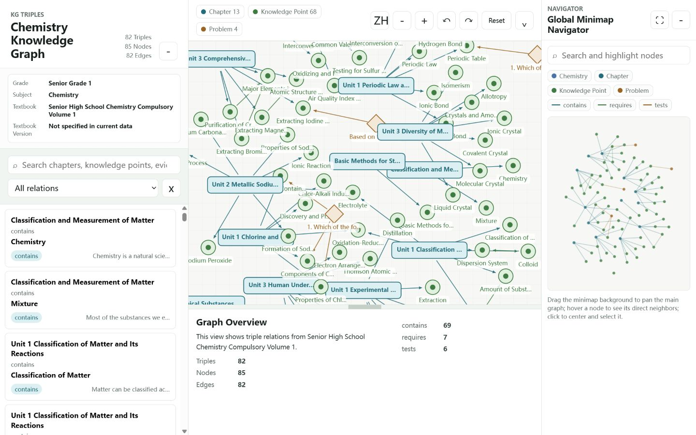

# FaMAS 化学 KG 可视化

[English](README.md) | 简体中文

本目录提供 FaMAS 化学知识图谱示例的只读静态查看器。它只使用原生 HTML、CSS、JavaScript 和 Canvas，不需要安装前端依赖，也不依赖后端 API。



## 启动可视化

查看器使用 `fetch()` 加载 JSON，因此不能可靠地通过 `file://` 直接双击 `index.html`。请在本目录启动 HTTP 服务。

### Python

```bash
cd visualization/chemistry
python -m http.server 8000
```

打开 `http://127.0.0.1:8000/`。最终交付包不再包含单独的 Node.js 启动脚本。

## 界面操作

### 三元组列表与筛选

- 在左侧搜索框输入章节、知识点、关系、ID 或证据文本，可筛选匹配的三元组。
- 使用关系下拉菜单查看全部关系，或只查看 `contains`、`requires`、`tests`。
- 点击列表中的三元组，会在图中突出其主语节点、谓词边和宾语节点，并打开详情。
- 点击关系筛选器旁的清除焦点按钮，可以取消当前图谱焦点。
- 使用左侧面板标题栏按钮可折叠或重新展开列表。

### 主图画布

- 将鼠标悬停在节点或边上，可查看简要预览。
- 点击节点或边，可在底部详情面板查看完整信息。
- 在画布空白区域拖动，可平移图谱。
- 使用鼠标滚轮，可围绕当前指针位置缩放。
- 拖动节点可临时调整位置；释放后节点重新参与力导向布局。
- 使用工具栏的 `+` 和 `-` 可从画布中心放大或缩小。
- 使用旋转按钮可按每次 10 度旋转图谱。
- 点击**重置**可恢复默认视图，并清除当前选择。
- 点击 **ZH/EN** 可载入对应的中文或英文数据与界面文字。

### 详情面板与 FigureRef

- 底部详情面板展示当前节点、边或三元组的属性与证据。
- 拖动详情面板上方的水平分隔条可以调整面板高度。
- 使用工具栏中的详情按钮可以折叠或重新展开面板。
- 点击可交互的图片卡片，可查看教材原图裁剪、FigureRef ID、标题和经过验证的描述。
- 使用关闭按钮、点击背景或按 `Esc` 键均可关闭图片预览。

### 全局缩略图

- 在缩略图搜索框输入文字，可以让匹配节点产生脉冲提示，而不改变左侧三元组筛选。
- 将鼠标悬停在缩略图节点上，会为当前节点及其一跳邻居分别显示标签，并突出它们之间的边。
- 点击缩略图节点，会将主图居中并缩放到该节点、选中该节点，并持续显示其一跳上下文标签。
- 点击缩略图背景，会把主图中心移动到对应位置。
- 拖动缩略图背景，可平移主图。
- 点击缩略图标题栏中的展开按钮可打开更大的浮层视图；拖动任一边或角可调整浮层尺寸。
- 点击还原按钮、浮层背景或按 `Esc` 键可回到右侧停靠的缩略图。
- 使用右侧标题栏按钮可以折叠或重新展开缩略图。

## 数据规模

中英文数据使用相同的图谱 ID 和拓扑结构。

| 项目 | 数量 |
| --- | ---: |
| 节点 | 85 |
| 边 | 82 |
| 三元组 | 82 |
| `ChapterSection` 节点 | 13 |
| `KnowledgePoint` 节点 | 68 |
| `Problem` 节点 | 4 |
| `contains` 边 | 69 |
| `requires` 边 | 7 |
| `tests` 边 | 6 |
| FigureRef 图片 | 60 |

公开版本已从可视化数据中删除机器相关的 `source_path`，节点、边、三元组和 FigureRef ID 保持不变。示例中有一个孤立节点 `canon_knowledgepoint_465259580031`，由于没有相连的边，它会单独显示。

## 目录结构

```text
visualization/chemistry/
├── assets/
│   ├── images/                    # 60 张 FigureRef 图片裁剪
│   └── preview.png                # README 预览图
├── data/
│   ├── en/
│   │   ├── merged_nodes.json
│   │   ├── merged_edges.json
│   │   └── triples.json
│   └── zh/
│       ├── merged_nodes.json
│       ├── merged_edges.json
│       └── triples.json
├── app.js                         # 数据加载、交互、布局和绘制
├── index.html                     # 查看器入口
├── minimap-helpers.js             # 一跳标签与可调尺寸缩略图几何逻辑
├── server.js                      # 可选的零依赖本地服务器
└── styles.css                     # 响应式界面样式
```

## 常见问题

- **页面提示无法加载数据：** 确认地址以 `http://` 开头，而不是 `file://`。
- **JSON 或图片请求返回 404：** 必须在 `visualization/chemistry/` 目录启动服务器；从其他目录启动会改变相对资源路径。
- **8000 或 5173 端口被占用：** 可运行 `python -m http.server 8080`，或在运行 `node server.js` 前设置 `PORT=8080`。
- **缩略图标签过于密集：** 展开或调整缩略图尺寸，再悬停或选中节点以单独查看其一跳上下文。
- **切换语言后搜索内容被清空：** 语言切换会重新载入相应数据；对应 ID 仍存在时，当前节点选择、图谱焦点、关系筛选和画布视图会保留。

该查看器只提供读取和浏览功能，不会上传、编辑、持久化或导出图谱数据；本地文件加载完成后不需要网络连接。
